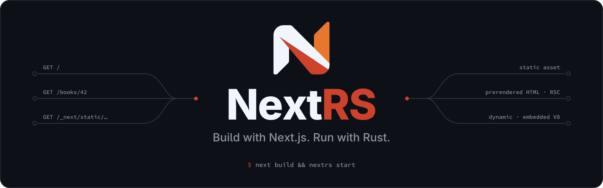
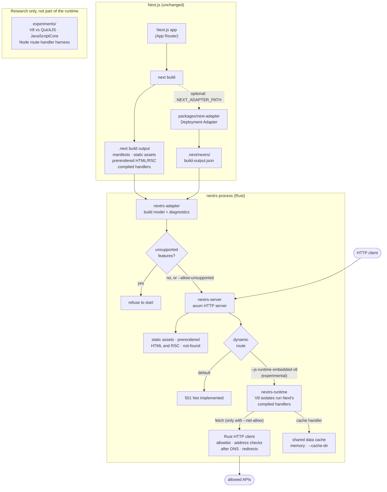

<p align="center">
  
</p>

<h1 align="center">NextRS</h1>

<p align="center">
  <strong>NextRS is an experimental Rust runtime for serving official Next.js build output, exploring a future where Next.js applications can run with Rust-powered server infrastructure.</strong>
</p>

<p align="center">
  <a href="#project-status-experimental"></a>
  <a href="https://www.rust-lang.org/"></a>
  <a href="https://nextjs.org/"></a>
  <a href="https://nextjs.org/docs/app"></a>
</p>

<p align="center">
  <a href="#what-is-nextrs">Overview</a> ·
  <a href="#current-capabilities">Current Capabilities</a> ·
  <a href="#architecture">Architecture</a> ·
  <a href="#getting-started">Getting Started</a> ·
  <a href="#compatibility-and-testing">Compatibility</a> ·
  <a href="#roadmap">Roadmap</a> ·
  <a href="#documentation">Documentation</a>
</p>

The goal:

```bash
next build && nextrs start
```

NextRS is an independent compatibility project. It is **not** an official
Next.js runtime, and it is **not** a production-ready replacement for
`next start`.

## Project Status: Experimental

NextRS has completed **Phase 0** (serving prerendered build output from
Rust) and **Phase 1A** (running Next.js's own compiled route handlers in an
embedded V8 isolate), **Phase 1B** (hardening that executor: bounded
streaming, supervision, limits and an isolate pool), **Phase 1C**
(outbound `fetch` as an explicit, SSRF-guarded capability, and a data cache
shared by every isolate and optionally persisted), **Phase 1D** (Server
Actions, run by Next's own compiled handlers), **Phase 1E** (ISR,
regenerated pages stored in that shared cache, revalidation from Server
Actions, and Cache Components) and, experimentally, **Phase 2A** (`proxy.ts`,
run as Next's compiled proxy in the same isolates, and `next.config`
headers, redirects, rewrites, `basePath` and `trailingSlash`). It is tested
against three small App Router fixtures built with Next.js 16.4.3, and also
passes the same comparison suites on 16.4.4 and 16.4.5.

- **Works:** `nextrs start` serves static assets, prerendered pages, React
  Server Components (RSC) payloads and the not-found page from Rust.
- **Experimental:** with `--js-runtime embedded-v8`, NextRS renders dynamic
  App Router pages and Route Handlers by calling the compiled handlers that
  `next build` produced. No Node.js or Deno process runs.
- **Off by default:** without that flag, every dynamic route answers an
  explicit `501 Not Implemented`.
- **Unsupported:** edge-runtime middleware, `next/image` optimization, the
  Pages Router, i18n and external rewrites. NextRS **refuses to start** when
  a build uses one it cannot answer explicitly, unless you pass
  `--allow-unsupported`.

> [!WARNING]
> NextRS is not ready for untrusted public traffic. It binds to `127.0.0.1`
> by default. See the [Security Notice](#security-notice).

## What is NextRS?

`next build` compiles a Next.js application into a `.next` directory:
manifests, hashed static assets, prerendered HTML and RSC payloads, and
compiled server handlers. Today that output is served by `next start`, a
Node.js server.

NextRS asks how much of that serving layer can run in Rust while consuming
the **same, unmodified build output**. It reads `.next` either through the
public [Next.js Deployment Adapter](https://nextjs.org/docs/app/api-reference/adapters)
API or from the internal manifests. It serves prerendered responses directly
from an [axum](https://github.com/tokio-rs/axum) HTTP server. For
server-side rendering (SSR), it hands requests to Next's own compiled handlers
running in an embedded JavaScript engine.

NextRS does **not** replace the Next.js compiler, the bundler, React or the
App Router. You keep building with Next.js. NextRS is concerned only with the
runtime and serving layer.

### Why Rust?

A Rust server layer has architectural properties worth exploring for Next.js
hosting:

- **Resource control:** memory is managed without a garbage collector, and
  per-request costs are explicit.
- **Memory safety:** the HTTP, routing and file-serving code is memory-safe
  without runtime checks. The NextRS crates contain no `unsafe` code.
- **Concurrency:** Tokio's multi-threaded scheduler serves static and
  prerendered responses without touching JavaScript.
- **Deployment:** the runtime is a single binary with V8 linked in, rather
  than a Node.js installation plus `node_modules`.

These are **design goals, not measured results**. NextRS makes no claim to be
faster, lighter or more scalable than `next start`. Early benchmark runs on
the five-route fixture are recorded in [`benchmarks/`](benchmarks/). They
come from one machine and one tiny app, and they are not representative of
real applications.

## Current Capabilities

| Capability | Status | Notes |
|---|---|---|
| Static assets (`/_next/static`, `public/`) | ✅ Supported | Served from the build output, with ETags and immutable caching for hashed assets |
| Prerendered App Router pages | ✅ Supported | HTML stored by `next build` |
| Prerendered RSC payloads | ✅ Supported | Full payloads and segment prefetches, including the `_rsc` cache-busting check |
| Not-found handling | ✅ Supported | Serves the prerendered not-found page with a `404` |
| Build inspection and unsupported-feature detection | ✅ Supported | `nextrs inspect` and the startup check |
| Dynamic App Router pages (SSR, streaming) | 🧪 Experimental | Requires `--js-runtime embedded-v8`; otherwise `501` |
| Route Handlers (`route.ts`, Node.js runtime) | 🧪 Experimental | Requires `--js-runtime embedded-v8`; otherwise `501` |
| Streamed request bodies | 🧪 Experimental | Pulled as the handler reads them; `--max-request-body` limit, including chunked uploads |
| Multi-core isolate pool | 🧪 Experimental | `--isolates N`; bounded admission, supervision and restart per isolate |
| Outbound `fetch` from server code | 🧪 Experimental | Denied unless `--net-allow` names the destination; hosts must resolve to public addresses (or `--net-allow-addr` ranges); redirects re-checked |
| Next.js data cache (`fetch` cache, `unstable_cache`, `revalidateTag`) | 🧪 Experimental | One cache for all isolates; persisted across restarts with `--cache-dir` |
| `generateStaticParams` | 🧪 Experimental | Listed params are served prerendered; with the executor, other params are rendered on their first request and cached (Next's `dynamicParams`) |
| Edge runtime routes | ⛔ Unsupported | Answers `501` |
| Server Actions (forms, client calls, bound and closure actions, uploads, redirects, cookies) | 🧪 Experimental | Requires `--js-runtime embedded-v8` (otherwise a startup refusal); Node.js runtime only; also on ISR pages; not with interception routes |
| `proxy.ts` / `middleware.ts` (Node.js runtime) | 🧪 Experimental | Requires `--js-runtime embedded-v8` (otherwise a startup refusal). Next's compiled proxy runs in the isolate pool before every matched request, prerendered and cached pages included: redirects, rewrites, request and response headers, cookies, direct responses. A proxy error, timeout or isolate failure never falls through to the route |
| Edge-runtime middleware | ⛔ Unsupported | Startup refusal |
| ISR (`revalidate`, on-demand `revalidatePath`/`revalidateTag`/`updateTag`) | 🧪 Experimental | Requires `--js-runtime embedded-v8`. Next's handler regenerates; pages are stored in the shared cache (persisted with `--cache-dir`) and seen by every isolate |
| Cache Components (`"use cache"`, `cacheLife`, `cacheTag`) | 🧪 Partial | `"use cache"` functions share one cache across isolates; Partial Prerendering shells are completed by Next's handler. `"use cache: private"` and custom `cacheHandlers` are untested |
| `next.config` headers, redirects, rewrites (beforeFiles, afterFiles, fallback; `has`/`missing`) | 🧪 Experimental | Applied in Rust in `next start`'s order from `routes-manifest.json`; no executor needed |
| Rewrites to another origin (config or proxy) | ⛔ Unsupported | Answers `501` (`external-rewrite`); not proxied |
| `basePath`, `trailingSlash` | 🧪 Experimental | Tested in separate fixture builds |
| i18n | ⛔ Unsupported | Startup refusal |
| Pages Router | ⛔ Unsupported | Startup refusal |
| Image optimization (`/_next/image`) | ⛔ Unsupported | Answers `501` |
| Interception routes (with the executor) | ⛔ Unsupported | Answers `501` |

Every refusal is a `501` response with an `x-nextrs-unsupported` header that
names the missing feature. NextRS returns this rather than an answer that
might be wrong.

### What Works Today

- **Build output inspection:** `nextrs inspect` reports the Next.js version,
  routes, how each one is rendered, what is stored for it, and diagnostics.
- **Static and prerendered serving:** hashed assets, `public/` files,
  prerendered HTML, RSC payloads and segment prefetches, and the not-found
  page, served from Rust.
- **Experimental dynamic rendering:** with `--js-runtime embedded-v8`, the
  fixture's dynamic pages and Route Handlers render through Next's
  unmodified compiled handlers. Responses stream, and request-scoped state
  (`headers()`, `cookies()`, params, `React.cache`, `after()`) stays
  isolated between concurrent requests.
- **A bounded, supervised executor:** a configurable pool of V8 isolates
  (`--isolates`), each on its own thread. Admission is bounded (busy pools
  answer `503` with `Retry-After`). Responses apply backpressure to the
  renderer, so a slow client cannot grow server memory. Request bodies
  stream into the handler, with a size limit for any framing. A failed or
  stuck isolate is terminated and replaced while the others keep serving.
- **Outbound fetch, as a capability:** with `--net-allow`, server code can
  call allowed APIs. Addresses are checked after DNS resolution by the same
  resolver the client connects with, so DNS tricks, redirects and encoded
  IP literals cannot reach loopback, private networks or cloud metadata
  services. Responses stream with backpressure, and every fetch is bounded
  by timeouts and a size limit and aborted when its request ends.
- **A shared data cache:** cached `fetch` results and `unstable_cache`
  entries live in one Rust store for every isolate, follow Next's
  revalidation and tag rules, and persist across restarts with
  `--cache-dir`. JavaScript never gets file access to it.
- **ISR and Cache Components:** time-based and on-demand ISR, unlisted
  `generateStaticParams` params and ISR route handlers are regenerated by
  Next's own handler and stored in the same shared cache, so every isolate
  serves the same generation and the cache survives restarts with
  `--cache-dir`. A page missing in one isolate while another regenerates it
  waits for that result. `"use cache"` functions share one cache too.
- **Server Actions:** form actions (with and without JavaScript), Server
  Functions called from client code, bound arguments and encrypted
  closures, file uploads, redirects, cookies and errors behave as they do
  under `next start`. Next's compiled handler does the work: NextRS routes
  the requests and provides the Web APIs it needs (`FormData`, multipart
  parsing, AES-GCM in `crypto.subtle`). Mutations are never retried
  automatically.
- **Proxy and routing rules:** an unchanged `proxy.ts` runs as Next compiled
  it, at the point in the pipeline where `next start` runs it (after
  `next.config` headers and redirects, before rewrites, files, prerendered
  pages, ISR, routes and Server Actions). `next.config` headers, redirects
  and rewrites, `basePath` and `trailingSlash` are applied from Next's own
  compiled rules; the routing functions are checked against Next's own on
  thousands of generated cases.
- **Unsupported-feature detection:** `nextrs start` refuses builds it would
  serve incorrectly, instead of silently skipping middleware, redirects or
  security headers.
- **Compatibility tooling:** scripts that compare NextRS with `next start`
  byte for byte and semantically, and that check streaming and request
  isolation.

### What's Not Ready Yet

- **Dynamic SSR beyond the fixtures:** only the fixtures' routes have been
  verified.
- **Execution limits are per isolate, not per request:** many requests share
  an isolate. A request that keeps the CPU busy past `--js-stall-timeout`
  is stopped by terminating its **whole isolate**, which fails the other
  requests in it. Per-request deadlines (`--request-timeout`) cancel the
  request but do not interrupt running JavaScript.
- **Caching limits:** one cache directory serves one process (no sharing
  between processes or machines). Concurrent regenerations of one page are
  coalesced across the isolates of a process, not across processes. Each
  ISR request runs Next's handler in JavaScript, even for a cache hit. The
  build-time fetch cache (`.next/cache/fetch-cache`) is not reused. Cache
  entries and revalidated tags survive a restart with `--cache-dir`, where
  `next start` forgets its tags and `"use cache"` entries. Module state is
  per isolate.
- **Outbound fetch gaps:** no `data:` URLs, custom CAs, client certificates,
  proxies or HTTP/2. A fetch does not outlive the request that started it.
- **Node.js API coverage:** NextRS provides a narrow Node.js layer. Node's
  network modules (`http`, `https`, `net`, `dns`; use `fetch`), `zlib`,
  `child_process`, `worker_threads`, `crypto.subtle` beyond AES-GCM and
  `digest`, `vm` and native addons are unavailable.
- **Proxy limits:** edge-runtime middleware, external rewrites,
  `skipProxyUrlNormalize` and i18n are refused. A request body that reaches
  the proxy is buffered for the proxy and the route; above
  `proxyClientMaxBodySize` (10 MB by default) NextRS answers `413`, where
  `next start` truncates it. Each proxied request takes one more trip
  through an isolate. Only the fixture's proxy and rules have been
  verified; other combinations of `next.config` options are untested.
- **Image optimization:** not implemented. Server Actions on the edge
  runtime are refused.
- **Other framework features:** the Pages Router, edge runtime routes,
  interception routes and response compression are not implemented.
- **Browser verification:** the Server Action pages are tested in Chromium
  against `next start` (hydration, submissions, pending states, redirects,
  cookies, errors, progressive enhancement). The other fixture pages are
  compared by their HTML and RSC bytes only.

## Architecture



1. **`next build`** produces the `.next` directory as usual. Optionally, the
   NextRS Deployment Adapter also writes `.next/nextrs/build-output.json`
   through Next's public adapter API.
2. **`nextrs-adapter`** builds one model of the routes, prerendered
   responses and configuration. It prefers the adapter output and falls back
   to the internal manifests. Every feature NextRS cannot honor becomes a
   diagnostic.
3. **Startup check:** if any diagnostic marks the build as unsupported,
   `nextrs start` exits instead of serving it incorrectly.
4. **`nextrs-server`** (axum + Tokio) answers static and prerendered
   requests directly from the build output.
5. **`nextrs-runtime`** (experimental) runs a supervised pool of V8
   isolates, each on a dedicated thread, built on `deno_core` with a
   NextRS-owned Node.js compatibility layer. Rust builds the request, calls
   Next's compiled `handler(req, res, ctx)`, and streams the response back
   under a per-response byte budget. Without this runtime, dynamic routes
   answer `501`.

## Getting Started

### Prerequisites

- **Rust 1.88 or later** (edition 2024)
- **Node.js 20.9 or later**, needed only to run `next build` and the
  comparison scripts
- Network access for the first build: the `v8` crate downloads a prebuilt
  static V8 library

### Build NextRS

```bash
git clone https://github.com/nextrs-sh/nextrs.git
cd nextrs
cargo build --release --bin nextrs
```

The release binary is about 79 MB because V8 is linked statically.

### Build the fixture application

Run this from the repository root:

```bash
cd fixtures/next-app
npm ci
npx next build
cd ../..
```

**Optional: build through the Deployment Adapter API.** The adapter is enabled
with an environment variable, so the application's `next.config` stays
unchanged. `NEXT_ADAPTER_PATH` must be an absolute path:

```bash
ADAPTER="$PWD/packages/next-adapter/index.mjs"
cd fixtures/next-app
NEXT_ADAPTER_PATH="$ADAPTER" npx next build
cd ../..
```

When `.next/nextrs/build-output.json` exists, NextRS reads it. Pass
`--ignore-adapter-output` to read the internal manifests instead.

### Inspect the build output

```bash
./target/release/nextrs inspect ./fixtures/next-app
```

```text
NextRS Inspector

Next.js version:  16.4.3 (from .next/diagnostics/framework.json)
Metadata source:  internal .next manifests (undocumented)
App Router:       detected
Pages Router:     not detected

Routes:
  /               page           prerendered  (stored: html + rsc + 3 segments)
  /_global-error  page           prerendered  (framework; stored: html + rsc + 3 segments)
  /_not-found     page           prerendered  (framework; stored: html + rsc + 3 segments)
  /api/health     route handler  dynamic
  /books/[id]     page           dynamic  (params: nxtPid)
  /dynamic        page           dynamic
  /request-info   page           dynamic
...
```

Add `--json` to get the full inspection as JSON.

### Start NextRS

Prerendered output only (the default):

```bash
./target/release/nextrs start ./fixtures/next-app --port 3001
```

```bash
curl -i http://127.0.0.1:3001/            # 200, prerendered HTML
curl -i http://127.0.0.1:3001/dynamic     # 501, x-nextrs-unsupported: javascript-required
```

With experimental dynamic rendering:

```bash
./target/release/nextrs start ./fixtures/next-app --port 3001 --js-runtime embedded-v8
```

| Option | Default | Purpose |
|---|---|---|
| `--host` | `127.0.0.1` | Bind address. Loopback by default for safety; a non-loopback address logs a warning |
| `--port`, `-p` | `3000` | Port |
| `--js-runtime` | `none` | `none` answers `501` for dynamic routes; `embedded-v8` executes them |
| `--js-env NAME` | none | Expose one host environment variable to JavaScript (repeatable). Nothing else is inherited; `NODE_ENV` is always `production` |
| `--allow-unsupported` | off | Start despite unsupported features. This does **not** add those features |
| `--ignore-adapter-output` | off | Read internal manifests even if adapter output exists |

Runtime limits (with `--js-runtime embedded-v8`; durations in seconds, `0`
disables a timeout):

| Option | Default | Purpose |
|---|---|---|
| `--isolates` | `1` | V8 isolates, each with its own thread, heap and event loop. Each extra isolate costs memory (on the fixture, about 10 MiB idle and 100-130 MiB under load) |
| `--max-concurrent` | `128` | Requests executing at once in one isolate |
| `--max-queued`, `--queue-timeout` | `512`, `10` | Requests waiting for an isolate, and for how long; beyond either, `503` with `Retry-After` |
| `--request-timeout` | `60` | Deadline per dynamic request, including `after()` work: `504`, or an aborted response if it already started |
| `--js-stall-timeout` | `10` | Terminate and replace an isolate whose JavaScript runs this long without yielding (affects every request in it) |
| `--js-heap-limit` | V8 default | Heap limit per isolate, in MiB; reaching it replaces the isolate. Lower values trade throughput for memory |
| `--response-buffer` | `64` | Response KiB buffered per request before the renderer waits for the client |
| `--max-request-body` | `10` | Request body limit in MiB (`413`), whether a length is declared or the body is chunked |
| `--max-connections`, `--write-timeout` | `1024`, `30` | Open connections; close clients that stop reading |
| `--shutdown-grace` | `10` | On SIGINT/SIGTERM, time for in-flight requests to finish |
| `--metrics-addr` | off | Serve `/metrics` (Prometheus text), `/metrics.json` and `/healthz` on a separate address. Keep it on loopback |
| `--v8-flags` | none | Experimental: V8 flags for tuning experiments (e.g. `"--max-semi-space-size=8"`). Unknown flags are refused; some flags weaken the sandbox |

Outbound network (denied unless `--net-allow` is given):

| Option | Default | Purpose |
|---|---|---|
| `--net-allow ORIGIN` | none | A destination JavaScript may fetch (repeatable): `api.example.com` (https, port 443 only), `api.example.com:8443`, `http://host:port`, or `*.example.com` (subdomains). Redirects must stay within these |
| `--net-allow-addr CIDR` | none | A non-public address or range allowed hosts may resolve to (repeatable), e.g. `127.0.0.1` for a local API. Loopback, private, link-local (cloud metadata) and other special ranges are refused otherwise |
| `--net-timeout`, `--net-body-timeout` | `30`, `30` | Time to the response head (including redirects and the request body); longest wait for the next body chunk |
| `--net-max-response` | `32` | Response body limit per fetch in MiB, after decompression |

```bash
./target/release/nextrs start ./my-app --js-runtime embedded-v8 \
  --net-allow api.example.com --net-allow "*.cdn.example.net"
```

Cache (the fetch cache, `unstable_cache`, ISR pages and route output, and
`"use cache"` entries, shared by all isolates):

| Option | Default | Purpose |
|---|---|---|
| `--cache-dir DIR` | none (memory only) | Persist the cache (directory created with mode 0700). Must be outside `.next` and `node_modules`. Entries are namespaced by build ID and JavaScript environment |
| `--cache-max-memory`, `--cache-max-disk` | `50`, `1024` | MiB of entries kept in memory and on disk; least recently used entries are evicted |
| `--cache-max-entry` | `2` | Larger data-cache values (`fetch`, `unstable_cache`) are not cached (MiB) |
| `--cache-max-response` | `16` | Larger ISR pages, route output and `"use cache"` values are not cached (MiB) |
| `--no-shared-cache` | off | Use Next's default handlers instead: separate per isolate, memory only. Refused with more than one isolate when the build has ISR or Server Actions |

Reverse proxies. Next.js trusts `X-Forwarded-Host` and `X-Forwarded-Proto`
(for the Server Action origin check, redirects and absolute URLs):

| Option | Default | Purpose |
|---|---|---|
| `--trusted-proxy CIDR` | none | Address or range of a reverse proxy (repeatable). Only connections from these addresses keep `X-Forwarded-*`, `X-Real-IP` and `Forwarded`; they are removed from every other request |
| `--strip-forwarded-headers` | off | Remove those headers from every request (no proxy in front) |

Without either option the headers are passed through from every client, as
with `next start`, so the proxy in front must overwrite them. With a chain of
proxies, list the one that connects to NextRS. `--trusted-proxy` never makes
an `Origin` acceptable that Next would refuse; it only decides whose
forwarded headers Next sees.

`cargo run --release --bin nextrs -- <command>` works in place of
`./target/release/nextrs`.

### Compare against `next start`

Start the official server on port 3000, keep NextRS on port 3001, and run the
comparison scripts from the repository root:

```bash
(cd fixtures/next-app && npx next start -H 127.0.0.1 -p 3000 &)

node tests/compat/compare.mjs   --baseline http://127.0.0.1:3000 --candidate http://127.0.0.1:3001
node tests/compat/semantic.mjs  --baseline http://127.0.0.1:3000 --candidate http://127.0.0.1:3001
node tests/compat/isolation.mjs --target http://127.0.0.1:3001
node tests/compat/streaming.mjs --target http://127.0.0.1:3001
```

`semantic.mjs`, `isolation.mjs` and `streaming.mjs` exercise dynamic routes,
so NextRS must be running with `--js-runtime embedded-v8`.

## Compatibility and Testing

NextRS treats `next start` as the reference: a response counts as compatible
only when it matches what the official server returns for the same build.

| Tool | What it checks |
|---|---|
| [`tests/compat/compare.mjs`](tests/compat/compare.mjs) | Status, headers and body of every fixture case against `next start`. An explicit `501` is reported as UNSUPPORTED, never as a match |
| [`tests/compat/semantic.mjs`](tests/compat/semantic.mjs) | Server-rendered DOM and the parsed RSC Flight tree, for output that is equivalent but chunked differently |
| [`tests/compat/isolation.mjs`](tests/compat/isolation.mjs) | Many overlapping requests with unique headers, cookies and params, plus client aborts: no request may see another's data |
| [`tests/compat/streaming.mjs`](tests/compat/streaming.mjs) | The Suspense shell reaches the client before the delayed boundary content |
| [`tests/compat/features.mjs`](tests/compat/features.mjs) | Isolation beyond headers: `React.cache`, concurrent Suspense, error boundaries, `after()`, concurrent uploads, and the intended scope of `unstable_cache` |
| [`tests/compat/data.mjs`](tests/compat/data.mjs) | Server-side `fetch` and the data cache against `next start`, through a local upstream ([`upstream.mjs`](tests/compat/upstream.mjs)) that counts requests: caching modes, revalidation, tags, cache identity, dedupe, errors, cancellation, and sharing across isolates |
| [`tests/compat/restart.mjs`](tests/compat/restart.mjs) | Cache persistence across a restart of both servers: data entries and an ISR page |
| [`tests/compat/isr.mjs`](tests/compat/isr.mjs) | ISR against `next start`: fresh and stale serving, background regeneration, on-demand params, ISR route handlers, 100 concurrent requests on a stale page, failed regeneration, Server Actions that revalidate an ISR page each way (also bound, no-JavaScript and concurrent), visibility in every isolate, private routes and cache poisoning attempts |
| [`tests/compat/cache-components.mjs`](tests/compat/cache-components.mjs) | `"use cache"`, `cacheLife` and `cacheTag` on the Cache Components fixture ([`fixtures/next-cache-components`](fixtures/next-cache-components)) against `next start`, sharing across isolates, and an entry across a restart |
| [`tests/compat/actions.mjs`](tests/compat/actions.mjs) | Server Action requests against `next start`: origin (CSRF) and method checks, invalid and foreign action IDs, encrypted closures (valid and tampered), body limits, malformed and hostile payloads, concurrent mutations and request identity, disconnects, cache invalidation; plus NextRS's own limits, isolate failure (no replay) and deadlines |
| [`tests/browser/actions.mjs`](tests/browser/actions.mjs) | The Server Action fixtures driven in Chromium (playwright-core), with and without JavaScript: what a user sees, cookies, and every action request's status and headers, against `next start` |
| [`tests/compat/proxy.mjs`](tests/compat/proxy.mjs) | `proxy.ts` on [`fixtures/next-proxy`](fixtures/next-proxy) against `next start`: continue, redirects, rewrites, header and cookie changes, matchers with `has`/`missing`, direct responses, errors, bodies, prerendered and ISR pages behind a synthetic login, Server Actions through the proxy (executed once, or never when redirected), concurrent isolation, internal-header and path-normalization bypass attempts; plus NextRS's timeout, stall and abort handling |
| [`tests/compat/routing-config.mjs`](tests/compat/routing-config.mjs) | `next.config` headers, redirects and rewrites on the same fixture, in its default, `basePath` and `trailingSlash` builds |
| [`tests/browser/proxy.mjs`](tests/browser/proxy.mjs) | Client-side navigation through the proxy and config rules in Chromium, against `next start` |
| [`scripts/compat-suite.sh`](scripts/compat-suite.sh) | Builds the fixtures (optionally against another Next.js version, in a temporary copy) and runs all of the above against `next start` (the browser suites with `--browser`, the proxy suites with `--proxy`) |

Recorded runs are kept next to the scripts as JSON (`tests/compat/*.json`).

### Rust checks

```bash
cargo fmt --all -- --check
cargo clippy --workspace --all-targets -- -D warnings
cargo test --workspace
```

`cargo test` links V8 through `nextrs-runtime`. The unit and HTTP tests use
[`tests/data`](tests/data/), redacted snapshots of real Next.js 16.4.3
`.next` output (default and adapter builds), so they do not need Node.js.
The executor's own tests (backpressure, supervision and fault injection,
deadlines, the isolate pool, request bodies) use small handler fixtures
and need no Next.js build. Tests that need the real fixture build are
ignored by default. They cover dynamic routes, and reliability over real
sockets: slow and disconnecting clients, body limits, overload, CPU stalls
and shutdown, plus process memory with paused clients.

```bash
cargo test -p nextrs-server --test dynamic --test reliability --test memory -- --ignored
```

CI ([`.github/workflows/ci.yml`](.github/workflows/ci.yml)) runs the Rust
checks, the ignored tests, and `scripts/compat-suite.sh` on the pinned
Next.js 16.4.3 build with 1 and 4 isolates. It also runs the suite on
newer 16.4.x releases without gating.

[`scripts/snapshot-build.mjs`](scripts/snapshot-build.mjs) regenerates a
snapshot from a `.next` directory and replaces build-time secrets with
placeholders.

### JavaScript engine experiments

The engine experiments are standalone crates outside the main workspace, so
`cargo test` never builds them.

- [`experiments/js-runtime`](experiments/js-runtime/) compares V8
  (`deno_core`) and QuickJS (`rquickjs`) on React SSR, RSC Flight and loading
  real Next.js route bundles. Run it with
  [`run-all.sh`](experiments/js-runtime/run-all.sh) after building the
  fixture.
- [`experiments/javascriptcore`](experiments/javascriptcore/README.md) is a
  bounded JavaScriptCore spike against the system WebKitGTK library.
- [`experiments/route-handler-harness`](experiments/route-handler-harness/harness.cjs)
  is a minimal Node.js host that calls Next.js route handlers directly and
  records the Node built-ins, files and environment variables they use.

### Benchmarks

[`benchmarks/bench.py`](benchmarks/bench.py) (static serving),
[`benchmarks/dynamic_bench.py`](benchmarks/dynamic_bench.py) (dynamic
rendering) [`benchmarks/pool_bench.py`](benchmarks/pool_bench.py)
(isolate pool sizes) and [`benchmarks/phase1c_bench.py`](benchmarks/phase1c_bench.py)
(outbound fetch and the data cache, warm and cold), [`benchmarks/actions_bench.py`](benchmarks/actions_bench.py)
(Server Actions: small and multipart calls, uploads, no-JavaScript forms
and encrypted closures) and [`benchmarks/phase1e_bench.py`](benchmarks/phase1e_bench.py)
(cache hits, ISR regeneration under load, revalidation from actions and
`"use cache"`, kept apart from dynamic rendering) drive `next start`, NextRS and reference hosts against
the same build. [`slow_clients.py`](benchmarks/slow_clients.py),
[`soak.mjs`](benchmarks/soak.mjs) (run per pool size by
[`soak-matrix.sh`](benchmarks/soak-matrix.sh)) and
[`recovery.mjs`](benchmarks/recovery.mjs) measure memory with paused
clients, sustained mixed traffic with injected isolate stalls (including
V8 heap after full GC), and recovery time. Each path's responses must be equivalent before it is measured. Raw
results are in [`benchmarks/results`](benchmarks/results/). They are
exploratory measurements from one fixture on one machine, not performance
claims.

## Repository Structure

| Path | Responsibility |
|---|---|
| [`crates/nextrs-adapter`](crates/nextrs-adapter/) | Reads `.next` (Deployment Adapter output or internal manifests) into one build model with diagnostics |
| [`crates/nextrs-server`](crates/nextrs-server/) | axum HTTP server: static and prerendered output, dispatch of dynamic routes to the executor |
| [`crates/nextrs-runtime`](crates/nextrs-runtime/) | Experimental embedded V8 executor (`deno_core`, `deno_web`, NextRS Node.js layer, filesystem sandbox) |
| [`crates/nextrs-cli`](crates/nextrs-cli/) | The `nextrs` binary: `inspect` and `start` |
| [`packages/next-adapter`](packages/next-adapter/) | Next.js Deployment Adapter that writes `.next/nextrs/build-output.json` |
| [`fixtures/next-app`](fixtures/next-app/) | Next.js 16.4.3 App Router compatibility fixture |
| [`tests/compat`](tests/compat/) | Byte, semantic, isolation and streaming checks against `next start` |
| [`tests/data`](tests/data/) | Redacted `.next` snapshots used by `cargo test` |
| [`experiments/js-runtime`](experiments/js-runtime/) | V8 and QuickJS engine experiment (standalone crate) |
| [`experiments/javascriptcore`](experiments/javascriptcore/) | JavaScriptCore spike (standalone crate) |
| [`experiments/route-handler-harness`](experiments/route-handler-harness/) | Node.js host that calls Next.js route handlers directly |
| [`benchmarks`](benchmarks/) | Benchmark drivers and raw results |
| [`scripts`](scripts/) | Test snapshot tooling |

## Roadmap

| Phase | Scope | Status |
|---|---|---|
| **Phase 0: build output feasibility** | Read `.next` through the adapter API and internal manifests; serve static and prerendered output from Rust; unsupported-feature detection; comparison harness against `next start` | ✅ Completed |
| **Phase 1A: embedded JavaScript execution** | Run Next's compiled App Router handlers in embedded V8 with no Node.js process; streaming; request isolation; engine evaluation (V8, QuickJS, JavaScriptCore, Deno, Bun) | ✅ Completed |
| **Phase 1B: executor hardening** | Response backpressure; executor supervision and restart; request deadlines and a CPU stall watchdog (per isolate); streamed request bodies; a multi-core isolate pool with bounded admission; metrics; fixtures for request bodies, `React.cache`, `after()`, error boundaries and `generateStaticParams`; CI against several Next.js 16.4.x versions | ✅ Completed (conditional: CI on GitHub and a multi-hour soak still to run) |
| **Phase 1C: capabilities and validation** | CI on GitHub and long soaks; outbound `fetch` as an explicit, SSRF-guarded capability; Next's data cache, shared by every isolate and optionally persisted | 🧪 Implemented (6-hour soak at 4 isolates passed; 1 and 2 isolates not re-soaked) |
| **Phase 1D: Server Actions** | Server Actions and Server Functions through Next's compiled handlers: routing, `FormData` and multipart, AES-GCM for encrypted closures, Next's requests to its own server, mutation failure semantics, browser tests | 🧪 Implemented (conditional: see What's Not Ready Yet) |
| **Phase 1E: regeneration** | ISR through Next's handler with regenerated pages in the shared cache, single-flight regeneration across isolates, tag revalidation semantics, Server Actions on ISR pages, Cache Components (`"use cache"`), a trusted reverse proxy mode | 🧪 Implemented (see What's Not Ready Yet) |
| **Phase 2A: proxy and routing** | Next's compiled `proxy.ts` in the isolate pool, `next start`'s routing order, `next.config` headers, redirects and rewrites, `basePath`, `trailingSlash`, proxy security regression tests | 🧪 Experimental (see What's Not Ready Yet) |
| **Later: advanced Next.js features** | Image optimization, draft mode, ISR fallback shells, the Pages Router | 🗓️ Planned |
| **Later: performance and production readiness** | Performance work, measured only once correctness is established; operational hardening | 🗓️ Planned |

No release dates are planned. Scope changes as the experiments produce
evidence.

## Documentation

- **This README** is the project's public documentation. The design records
  and phase reports are not published yet.
- **Engine experiments:** [`experiments/javascriptcore/README.md`](experiments/javascriptcore/README.md)
  and [`experiments/js-runtime/run-all.sh`](experiments/js-runtime/run-all.sh)
- **Compatibility tests:** [`tests/compat`](tests/compat/). Each script
  documents its usage in its header comment.
- **Benchmark methodology and results:** the docstrings of
  [`benchmarks/bench.py`](benchmarks/bench.py) and
  [`benchmarks/dynamic_bench.py`](benchmarks/dynamic_bench.py), and the raw
  data in [`benchmarks/results`](benchmarks/results/)
- **CLI reference:** `nextrs --help`, `nextrs inspect --help`,
  `nextrs start --help`

Official Next.js documentation:

- [`next` CLI (`next build`, `next start`)](https://nextjs.org/docs/app/api-reference/cli/next)
- [Deployment Adapters](https://nextjs.org/docs/app/api-reference/adapters)
  and [`adapterPath` / `NEXT_ADAPTER_PATH`](https://nextjs.org/docs/app/api-reference/config/next-config-js/adapterPath)
- [Deploying Next.js](https://nextjs.org/docs/app/getting-started/deploying)
- [App Router](https://nextjs.org/docs/app)

NextRS is an independent experimental project. It is not affiliated with,
endorsed by or supported by Vercel or the Next.js team. "Next.js" is a
trademark of Vercel, Inc.

## Contributing

NextRS is at an early research stage. Please open an issue before starting
larger changes. Every change must pass the [Rust checks](#rust-checks). If it
affects serving behavior, also run the comparison against `next start`.

## Security Notice

> [!CAUTION]
> **NextRS is experimental software. Do not expose it to untrusted traffic.**

- **Loopback by default:** `nextrs start` binds to `127.0.0.1` unless you pass
  `--host`, and it logs a warning for any other address.
- **The JavaScript engines are not hardened:** this applies to the embedded
  V8 executor and to the engine experiments. Do not put either in front of
  untrusted traffic.
- **A V8 isolate is a memory boundary, not a security boundary:** run one
  application per process. Running untrusted applications side by side would
  also require operating-system sandboxing.
- **The executor's sandbox is narrow:** JavaScript can read only `.next`
  and `node_modules`. It cannot write files or spawn processes. It sees only
  `NODE_ENV=production`, the variables passed with `--js-env NAME`, and
  `NEXT_SERVER_ACTIONS_ENCRYPTION_KEY` when it is set (as `next start`
  reads it).
- **Network access is opt-in and checked in Rust:** without `--net-allow`,
  `fetch` fails. With it, only the listed origins are reachable, and only at
  public addresses unless `--net-allow-addr` names a range. Proxy variables
  are ignored. Allow only what the application needs: an allowed
  destination receives whatever the application sends it.
- **The data cache is written by Rust, not by JavaScript:** JavaScript passes
  cache keys and values; file names are hashes of the keys, files are
  private to the user, and the directory must be outside the paths
  JavaScript can read. Cached responses can contain user data, so treat the
  cache directory like application data.
- **CPU and heap limits are per isolate:** there is no per-request CPU
  limit. A request that keeps the CPU busy past `--js-stall-timeout`, or
  exhausts the heap, terminates its whole isolate and fails every request
  in it. Run more than one isolate to contain this.
- **Server Actions are public endpoints:** anyone who has a page can call
  its actions, so authorization belongs in each action, as with `next
  start`. Next's own checks run unchanged: the `Origin` comparison (with
  `serverActions.allowedOrigins`), body limits and closure decryption.
  That comparison trusts `X-Forwarded-Host`, so behind a proxy, make the
  proxy overwrite it, or use `--trusted-proxy` (or
  `--strip-forwarded-headers` without a proxy). Next's requests to its own server (redirect
  payloads, forwarding an action to another page) are served inside the
  process and never use the network. A request that reached JavaScript is
  never retried: if its isolate fails, the client gets a `502` and cannot
  know whether the mutation happened, so do not retry actions on `502` or
  `504` automatically.
- **The metrics endpoint is internal:** `--metrics-addr` exposes counters,
  per-isolate state and the first line of the last isolate failure (which
  can contain application error text). No request paths, headers, URLs or
  cache keys are used as labels. Keep it on loopback.
- **A proxy is not authorization:** NextRS runs the proxy exactly where and
  as `next start` does, including Next's matcher semantics, so a matcher
  that misses a path misses it here too. Check the session in Server
  Actions and route handlers as well.
- **`--allow-unsupported` removes a safety check:** it lets NextRS start a
  build that uses features it cannot apply (edge middleware, i18n, Pages
  Router). It does **not** implement them; a build with a proxy started
  without the executor answers `501` for every request the proxy matches.

## License

The workspace manifest ([`Cargo.toml`](Cargo.toml)) declares
`MIT OR Apache-2.0`, but the repository does not include license files yet.
