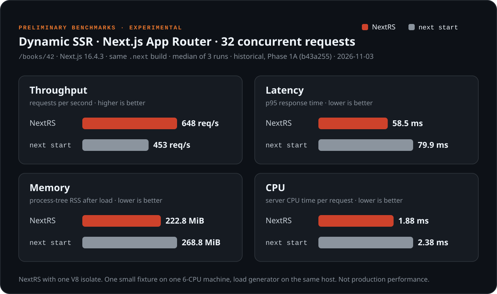

<p align="center">
  
</p>

<p align="center">
  <strong>An experimental Rust runtime for Next.js build output.</strong><br>
  Build your app with Next.js as usual, then serve the <code>.next</code> output from a Rust server,
  with Next.js's own compiled server code running in embedded V8.
</p>

<p align="center">
  <a href="#project-status"></a>
  <a href="engineering/compatibility.md"></a>
  <a href="https://www.rust-lang.org/"></a>
</p>

```bash
next build
nextrs start
```

<p align="center"><sub>The workflow NextRS is aiming for. There is no published package yet: build it from source with the <a href="#quick-start">Quick Start</a>.</sub></p>

> [!WARNING]
> **NextRS is experimental.** It is not ready for untrusted public traffic and
> it is not a production replacement for `next start`. It supports selected
> App Router features, verified on small test applications. Read the
> [security notice](engineering/security.md) before exposing it to a network.

## Why NextRS?

`next build` compiles your application into a `.next` directory: prerendered
pages, static assets and compiled server handlers. Normally `next start`
serves that output with Node.js. NextRS serves the **same, unmodified
output** from a single Rust process.

- **Keep your Next.js workflow.** Develop and build with Next.js and Node.js
  as you do today. NextRS does not rewrite React, Next.js or your code.
- **Rust handles the serving layer.** HTTP, routing, `next.config` rules,
  static files and prerendered pages are handled by an
  [axum](https://github.com/tokio-rs/axum) + Tokio server.
- **Next.js's own handlers run in embedded V8.** Dynamic routes execute the
  JavaScript that `next build` produced, in V8 isolates linked into the
  NextRS binary. No separate Node.js server process runs while serving.
- **Resources are explicit.** Isolate pools, queues, timeouts, body sizes and
  outbound network access are bounded and set from the command line.

These are design goals. The [early benchmarks](#performance-benchmarks) cover
one small workload, so NextRS makes no general claim to be faster or lighter
than `next start`.

## Features

- **Rust HTTP serving:** static assets, `public/` files, prerendered HTML and
  RSC payloads, served from Rust with Next's caching headers.
- **Dynamic SSR and React Server Components** *(experimental):* streaming
  server rendering through Next.js's compiled handlers.
- **Server Actions and Route Handlers** *(experimental):* forms, client
  calls, encrypted closures, uploads and `route.ts` handlers.
- **Proxy and routing** *(experimental):* `proxy.ts` on the Node.js runtime,
  plus `next.config` headers, redirects, rewrites, `basePath` and
  `trailingSlash`, applied in `next start`'s order.
- **ISR and caching** *(experimental):* ISR, on-demand revalidation, the
  data cache and `"use cache"`, in one cache shared by every isolate and
  optionally persisted to disk.
- **Image optimization and runtime controls** *(experimental):*
  `/_next/image` answered in Rust within a memory budget, outbound network
  denied by default, and supervised isolates that are replaced when they
  fail.

Not supported: the Pages Router, the edge runtime and Next's `i18n` config.
NextRS refuses to start a build it would serve incorrectly. See the
[compatibility reference](engineering/compatibility.md) for details.

## Architecture

<p align="center">
  
</p>

NextRS reads the `.next` output at startup and answers every request from one
Rust process. Static and prerendered responses never touch JavaScript.
Dynamic routes, Server Actions and `proxy.ts` run Next.js's own compiled
handlers in a pool of embedded V8 isolates, and their cache entries live in a
Rust store shared by every isolate.
[More in the architecture reference.](engineering/architecture.md)

## Performance Benchmarks

Early measurements comparing NextRS with the official Next.js server
(`next start`) on identical build output.

<p align="center">
  <picture>
    <source media="(max-width: 600px)" srcset=".github/assets/nextrs-benchmarks-mobile.svg">
    
  </picture>
</p>

> [!NOTE]
> **Benchmark notice.** These are historical results from 2026-11-03
> (Phase 1A, commit `b43a255`), not measurements of the current commit. They
> cover one dynamic page of a small fixture (Next.js 16.4.3, 32 concurrent
> requests, one V8 isolate) on a single machine, with the load generator on
> the same host. They do not represent production performance or other
> workloads. See [benchmark methodology and raw data](engineering/benchmarks.md).

## Quick Start

Build NextRS from source and serve the example app in
[`fixtures/next-app`](fixtures/next-app/).

**You need:** Rust 1.88 or later, Node.js 20.9 or later (only for
`next build`), and network access for the first build, which downloads a
prebuilt V8 library. CI builds and tests on Linux.

```bash
# 1. Build the NextRS CLI (V8 is linked statically, so this takes a while)
git clone https://github.com/nextrs-sh/nextrs.git
cd nextrs
cargo build --release -p nextrs-cli

# 2. Build the example app with Next.js, as usual
(cd fixtures/next-app && npm ci && npx next build)

# 3. Serve it with NextRS; dynamic routes need the embedded V8 runtime
./target/release/nextrs start fixtures/next-app --port 3001 --js-runtime embedded-v8
```

Open <http://127.0.0.1:3001>, or try it from another terminal:

```bash
curl -i http://127.0.0.1:3001/           # prerendered page, served from Rust
curl -i http://127.0.0.1:3001/books/42   # dynamic page, rendered by Next.js in V8
```

Without `--js-runtime embedded-v8`, NextRS runs no JavaScript: dynamic routes
answer an explicit `501`, and a build that needs JavaScript for Server Actions
or ISR, like this one, is refused at startup. To see how each route will be
served, run `./target/release/nextrs inspect fixtures/next-app`.

`nextrs start --help` lists every option. The
[configuration reference](engineering/configuration.md) explains limits,
network access, caching and reverse proxy settings.

> [!TIP]
> If the build runs out of memory, limit parallel jobs with
> `cargo build --release -j 2 -p nextrs-cli`.

## Project Status

NextRS is a research project, developed in the open.

- **Experimental:** not recommended for untrusted production traffic. It
  binds to `127.0.0.1` by default.
- **Selected features:** tested against ten small App Router applications
  with Next.js 16.4.3, and the same suites pass on 16.4.4 and 16.4.5.
- **A narrow Node.js layer:** Node's network modules (`http`, `net`, TCP
  sockets), `zlib`, `child_process` and native addons are unavailable, so
  many database drivers will not work.
- **Isolation limits:** a V8 isolate is a memory boundary, not a security
  boundary, and CPU limits apply per isolate, not per request.

Technical details: [Compatibility](engineering/compatibility.md) ·
[Security](engineering/security.md) ·
[Architecture](engineering/architecture.md) ·
[Engineering reference](engineering/README.md)

## Contributing

Issues and pull requests are welcome. Please
[open an issue](https://github.com/nextrs-sh/nextrs/issues) before starting a
larger change. Every change must pass the Rust checks, and changes to serving
behavior should pass the comparison against `next start`; see
[testing](engineering/testing.md).

## License

The workspace manifest ([`Cargo.toml`](Cargo.toml)) declares
`MIT OR Apache-2.0`, but the repository does not include license files yet.

NextRS is an independent project. It is not affiliated with, endorsed by or
supported by Vercel or the Next.js team. "Next.js" is a trademark of
Vercel, Inc.
