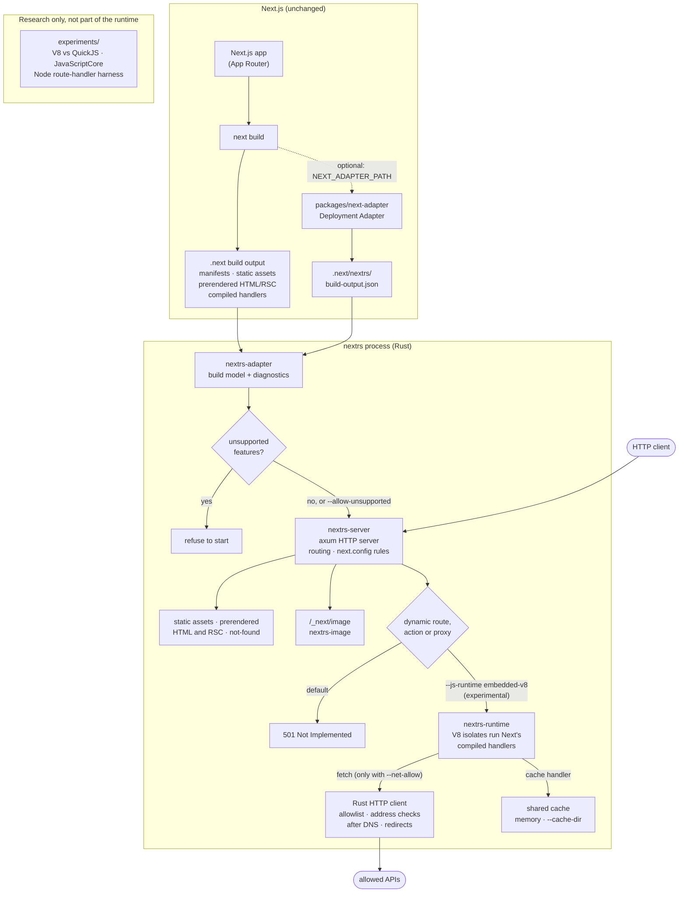

# Architecture

How NextRS turns a `.next` directory into a running server, and where each
part of the code lives.

- [Overview](#overview)
- [Request lifecycle](#request-lifecycle)
- [The V8 isolate pool](#the-v8-isolate-pool)
- [Cache](#cache)
- [Networking](#networking)
- [Image optimization](#image-optimization)
- [Repository structure](#repository-structure)
- [Engine experiments](#engine-experiments)

## Overview

`next build` compiles a Next.js application into a `.next` directory:
manifests, hashed static assets, prerendered HTML and RSC payloads, and
compiled server handlers. Normally that output is served by `next start`, a
Node.js server.

NextRS consumes the **same, unmodified build output**. It reads `.next`
either through the public
[Next.js Deployment Adapter](https://nextjs.org/docs/app/api-reference/adapters)
API or from the internal manifests. It serves static and prerendered
responses directly from an [axum](https://github.com/tokio-rs/axum) HTTP
server, and hands server-side rendering to Next's own compiled handlers
running in embedded V8.

NextRS does **not** replace the Next.js compiler, the bundler, React or the
App Router, and it does not rewrite any JavaScript in Rust. You keep building
with Next.js. NextRS is concerned only with the runtime and serving layer.

### Why a Rust serving layer

These are design motivations, **not measured results**. NextRS makes no claim
to be faster, lighter or more scalable than `next start`.

- **Resource control:** memory is managed without a garbage collector, and
  per-request costs (buffers, queues, connections) are explicitly bounded.
- **Memory safety:** the HTTP, routing and file-serving code is memory-safe.
- **Concurrency:** Tokio's multi-threaded scheduler serves static and
  prerendered responses without touching JavaScript.
- **Deployment:** the runtime is a single binary with V8 linked in, rather
  than a Node.js installation plus `node_modules` at serving time.

### Component diagram

The README shows a simplified version of this diagram
([`.github/assets/nextrs-architecture.svg`](../.github/assets/nextrs-architecture.svg)).

## Request lifecycle

1. **`next build`** produces the `.next` directory as usual. Optionally, the
   NextRS Deployment Adapter also writes `.next/nextrs/build-output.json`
   through Next's public adapter API.
2. **`nextrs-adapter`** builds one model of the routes, prerendered
   responses and configuration. It prefers the adapter output and falls back
   to the internal manifests. Every feature NextRS cannot honor becomes a
   diagnostic.
3. **Startup check:** if any diagnostic marks the build as unsupported,
   `nextrs start` exits instead of serving it incorrectly.
4. **Request arrives** at `nextrs-server` (axum + Tokio). Forwarded headers
   are filtered according to the reverse-proxy settings, and Next's internal
   headers are always removed from client requests.
5. **Routing** (`crates/nextrs-server/src/resolve.rs`) ports `next start`'s
   resolve-routes order: `next.config` headers and redirects, then the
   compiled `proxy.ts` (run in an isolate), then rewrites, files, prerendered
   pages, ISR, routes and Server Actions. The path-to-regexp, `has`/`missing`
   and destination logic in `routing/` is checked against vectors generated
   from Next's own functions.
6. **Serving:** static files, prerendered HTML and RSC, the not-found page
   and `/_next/image` are answered in Rust. Dynamic pages, Route Handlers,
   Server Actions and ISR requests go to the isolate pool.
7. **Execution:** Rust builds the request, calls Next's compiled
   `handler(req, res, ctx)` in an isolate, and streams the response back
   under a per-response byte budget. Without the runtime, dynamic routes
   answer `501`.

Next's requests to its own server (redirect payloads, forwarding an action
to another page) are dispatched inside the process and never use the
network.

## The V8 isolate pool

`nextrs-runtime` runs a supervised pool of V8 isolates (`--isolates`, default
1), each on a dedicated thread with its own heap and event loop. It is built
on `deno_core` with `deno_web` and a NextRS-owned Node.js compatibility layer
([`crates/nextrs-runtime/js`](../crates/nextrs-runtime/js/)); `deno_node` is
not used.

- **Dispatch:** busy-aware, least-outstanding requests first.
- **Admission:** bounded concurrency per isolate and a bounded queue; beyond
  either, `503` with `Retry-After`.
- **Backpressure:** each response has a byte budget released as the client
  reads, so a slow client stalls the renderer instead of growing memory.
- **Supervision:** an isolate that fails, stalls past `--js-stall-timeout`
  or hits its heap limit is terminated and replaced with backoff; the other
  isolates keep serving. Requests that reached JavaScript are never
  replayed.
- **Bootstrap:** loading Next's bundles is judged by
  `--js-bootstrap-timeout`, not the stall limit.
- **Sandbox:** JavaScript can read only `.next` and `node_modules`, cannot
  write files or spawn processes, and sees only the environment variables it
  is given. See [security.md](security.md).

Module state is per isolate: `instrumentation.ts` registers once per
isolate.

## Cache

One Rust store (`crates/nextrs-runtime/src/cache.rs`) backs Next's cache
handlers in every isolate: the data cache (`fetch`, `unstable_cache`), ISR
pages and route output, and `"use cache"` entries.

- In memory by default; persisted with `--cache-dir` (namespaced by build ID
  and JavaScript environment, files named by key hash, mode 0700).
- Tags are mirrored into Next's `tagsManifest` per isolate, so
  `revalidateTag`/`revalidatePath` behave as in `next start`.
- A regeneration lease coalesces concurrent regenerations of one page
  across the isolates of a process.
- JavaScript passes keys and values; it never gets file access to the
  cache.

## Networking

Outbound `fetch`, external rewrites and remote images share one policy
(`crates/nextrs-runtime/src/net.rs`):

- Destinations must match `--net-allow`.
- Addresses are checked after DNS resolution by the resolver the client
  connects with; loopback, private and link-local ranges need
  `--net-allow-addr`.
- Redirects are re-checked hop by hop.
- HTTP/1.1 through `reqwest` with rustls and the Mozilla root store; no
  system proxy.
- Timeouts, a response size limit, streaming with backpressure, and
  cancellation when the request ends.

## Image optimization

`/_next/image` is handled in `crates/nextrs-server/src/image/` with codecs in
[`crates/nextrs-image`](../crates/nextrs-image/): Rust decoders, resizing
that reproduces sharp's geometry, and WebP, AVIF, JPEG and PNG encoders.
Local sources are fetched through the normal routing pipeline as internal
subrequests; remote sources go through the network policy. Work runs on a
bounded blocking pool, never on the request threads or an isolate, with a
memory LRU and an optional disk cache.

Memory is bounded as well as concurrency. Before a transformation starts,
its peak allocation is estimated from the source's header alone (decoder
buffers, resize and encoder state) and reserved from a process-wide budget;
work waits in the bounded queue until both memory and a thread are free,
and keeps its reservation until it has actually finished, also after its
request timed out. Source bodies held in memory have a budget of their own.
JPEGs resized to half their width or less are decoded at 1/2, 1/4 or 1/8
scale (a scaled IDCT, as libvips does), so a large photo resized to a small
width never exists at full size. Decoders for untrusted bytes are Rust;
C code (libwebp, mozjpeg) only encodes pixels NextRS produced.

## Repository structure

| Path | Responsibility |
|---|---|
| [`crates/nextrs-adapter`](../crates/nextrs-adapter/) | Reads `.next` (Deployment Adapter output or internal manifests) into one build model with diagnostics |
| [`crates/nextrs-server`](../crates/nextrs-server/) | axum HTTP server: routing, static and prerendered output, `/_next/image`, dispatch of dynamic routes to the executor |
| [`crates/nextrs-runtime`](../crates/nextrs-runtime/) | Experimental embedded V8 executor (`deno_core`, `deno_web`, NextRS Node.js layer, filesystem sandbox, cache, network policy, Web Crypto) |
| [`crates/nextrs-image`](../crates/nextrs-image/) | Image decoding (Rust decoders only), resizing with sharp's geometry, and encoding |
| [`crates/nextrs-cli`](../crates/nextrs-cli/) | The `nextrs` binary: `inspect` and `start` |
| [`packages/next-adapter`](../packages/next-adapter/) | Next.js Deployment Adapter that writes `.next/nextrs/build-output.json` |
| [`fixtures/`](../fixtures/) | Next.js 16.4.3 App Router fixtures (see [compatibility.md](compatibility.md#tested-versions-and-fixtures)) |
| [`tests/compat`](../tests/compat/) | HTTP comparison suites against `next start` |
| [`tests/browser`](../tests/browser/) | Chromium suites against `next start` |
| [`tests/data`](../tests/data/) | Redacted `.next` snapshots used by `cargo test` |
| [`scripts`](../scripts/) | Suite runners, routing vector generator, snapshot tooling |
| [`benchmarks`](../benchmarks/) | Benchmark and soak drivers, raw results |
| [`experiments`](../experiments/) | JavaScript engine research (not part of the runtime) |

## Engine experiments

The engine experiments are standalone crates outside the main workspace, so
`cargo test` never builds them.

- [`experiments/js-runtime`](../experiments/js-runtime/) compares V8
  (`deno_core`) and QuickJS (`rquickjs`) on React SSR, RSC Flight and loading
  real Next.js route bundles. Run it with
  [`run-all.sh`](../experiments/js-runtime/run-all.sh) after building the
  fixture.
- [`experiments/javascriptcore`](../experiments/javascriptcore/README.md) is a
  bounded JavaScriptCore spike against the system WebKitGTK library.
- [`experiments/route-handler-harness`](../experiments/route-handler-harness/harness.cjs)
  is a minimal Node.js host that calls Next.js route handlers directly and
  records the Node built-ins, files and environment variables they use.
